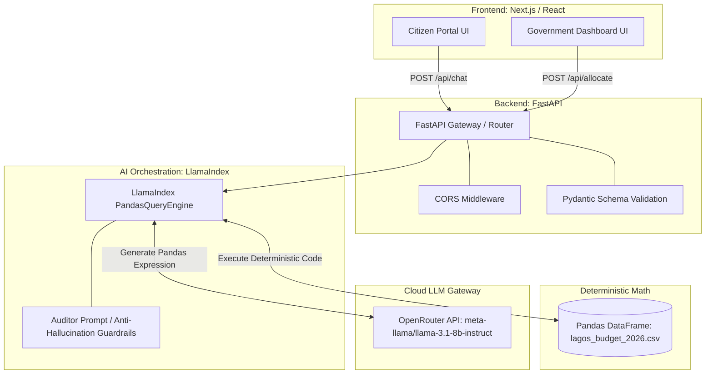

# NationOS — National Decision Intelligence Platform
**Lagos State 2026 Fiscal Planning & Civic Accountability Engine**

NationOS is an AI-assisted planning and public transparency platform engineered to eliminate the **Trust and Agility Deficit** in government financial administration. Built for the 2026 Fiscal Budget of Lagos State, Nigeria, NationOS bridges civic accountability and policymaking agility through a dual-portal architecture anchored in **mathematically deterministic AI**.

---

## Table of Contents
1. [Core Philosophy & Problem Statement](#core-philosophy--problem-statement)
2. [Dual-Portal Paradigm](#dual-portal-paradigm)
3. [System Architecture](#system-architecture)
4. [Data Schema & Domain Mechanics](#data-schema--domain-mechanics)
5. [AI Brain & Deterministic Query Engine](#ai-brain--deterministic-query-engine)
6. [API Specifications](#api-specifications)
7. [Repository Topology](#repository-topology)
8. [Setup & Execution Guide](#setup--execution-guide)
9. [Verification & Test Diagnostics](#verification--test-diagnostics)

---

## Core Philosophy & Problem Statement

Public sector budgeting often suffers from two opposing structural flaws:
* **The Transparency Deficit (Citizens):** Budgetary records are published in impenetrable multi-hundred-page PDF ledgers, obfuscating how public funds are apportioned across local communities and masking stalled infrastructure initiatives.
* **The Agility Deficit (Government):** When macroeconomic shocks occur (e.g., sudden revenue contractions, currency fluctuations, or subsidy adjustments), policymakers lack dynamic simulation tools to model reallocation trade-offs instantly without months of bureaucratic friction.

NationOS addresses both deficits using a unified ground truth dataset paired with an AI orchestration layer that enforces **zero numerical hallucination**.

---

## Dual-Portal Paradigm

```
                        ┌──────────────────────────────────────┐
                        │              NationOS                │
                        └──────────────────┬───────────────────┘
                                           │
                  ┌────────────────────────┴────────────────────────┐
                  ▼                                                 ▼
       [ Citizen Portal ]                                [ Government Portal ]
     * Plain-English queries                           * Scenario stress-testing
     * Localized LGA tracking                          * Proportional budget cuts
     * Project execution audit                         * Capital preservation rules
     * Disbursed vs. Approved ratio                    * Dynamic fiscal simulations
```

1. **Citizen Portal (Accountability & Transparency):**
   * Translates colloquial, plain-English inquiries into programmatic analytical queries.
   * Enables residents to inspect funding and project delivery status across Lagos State's 20 Local Government Areas (LGAs).
   * Calculates dynamic **project execution rates** ($\frac{\text{Actual Disbursed}}{\text{Approved Budget}}$) to flag stalled or abandoned public works.

2. **Government Portal (Decision Agility & Simulation):**
   * Acts as an intelligent policy simulation cockpit for ministry planners and financial analysts.
   * Evaluates macro-fiscal constraints (e.g., a 15% state revenue shortfall).
   * Computes precise, proportional expenditure reductions across operational line items (`Recurrent - Overhead`) while protecting vital infrastructure investments (`Capital`).

---

## System Architecture

NationOS is structured as a decoupled client-server architecture:



### Determinism Over Generative Guesswork
Large Language Models inherently struggle with multi-digit arithmetic and table aggregations. NationOS resolves this by treating the LLM strictly as an **analytical translator**:
* The LLM converts user intent into verified Python/Pandas aggregation expressions.
* The Pandas runtime executes the mathematical computations directly against the in-memory tabular ground truth.
* The resulting exact figures are rendered to the user, eliminating numerical drift or hallucination.

---

## Data Schema & Domain Mechanics

The core ground truth is maintained in [`backend/lagos_budget_2026.csv`](backend/lagos_budget_2026.csv), synthesized via [`backend/generate_data.py`](backend/generate_data.py).

### Schema Definition

| Column | Type | Description | Example |
| :--- | :--- | :--- | :--- |
| `fiscal_year` | `Integer` | Fiscal budgeting cycle | `2026` |
| `mda` | `String` | Ministry, Department, or Agency | `Ministry of Works and Infrastructure` |
| `sector` | `String` | Macro-governance classification | `Economic`, `Social`, `Administration`, `Law & Justice` |
| `expenditure_type` | `String` | Line-item budget categorization | `Capital`, `Recurrent - Personnel`, `Recurrent - Overhead` |
| `project_description`| `String` | Human-readable specification | `Construction of Eti-Osa Regional Road Section 2` |
| `lga` | `String` | Local Government Area in Lagos | `Eti-Osa`, `Alimosho`, `Ikeja`, etc. |
| `approved_budget_naira`| `Float` | Legally allocated fiscal ceiling | `1,538,824,624.79` |
| `actual_disbursed_naira`| `Float`| Capital or operational funds released | `1,406,675,130.60` |

### Domain Characteristics & Realism
* **Coverage:** 500 line items spanning all 20 LGAs of Lagos State.
* **Fiscal Scale:** ~₦646.35 Billion in approved budget, ~₦389.26 Billion in disbursed funds (aggregate execution rate: ~60.22%).
* **Execution Variance (Accountability Simulation):**
  * **12% Stalled Initiatives:** 0% disbursement (bureaucratic holds, stalled contractor onboarding).
  * **16% Bottlenecked Projects:** 5% - 25% disbursement (severe funding delays).
  * **30% Mid-Stage Works:** 30% - 65% disbursement.
  * **30% On-Track Projects:** 70% - 94% disbursement.
  * **12% Completed Milestones:** 95% - 100% disbursement.
* **Personnel Protection:** Recurrent personnel expenditure maintains an 88% - 100% disbursement index, mirroring civil service wage prioritisation.

---

## AI Brain & Deterministic Query Engine

Implemented in [`backend/ai_engine.py`](backend/ai_engine.py):

* **Framework:** `LlamaIndex` (`llama-index-core` + `llama-index-experimental`).
* **LLM Provider:** OpenRouter routing `meta-llama/llama-3.1-8b-instruct` at `temperature=0.0`.
* **Auditor Guardrail Prompt:**
  ```text
  You are a strict financial auditor for Lagos State.
  You must use the provided Pandas DataFrame to answer queries mathematically.
  Never guess or hallucinate numbers.
  Return monetary values formatted in Naira (₦).
  ```

---

## API Specifications

The FastAPI application in [`backend/main.py`](backend/main.py) exposes the following endpoints:

### 1. Health Probe
* **Endpoint:** `GET /health`
* **Response:**
  ```json
  {
    "status": "ok"
  }
  ```

### 2. Citizen Portal Query
* **Endpoint:** `POST /api/chat`
* **Request Body:**
  ```json
  {
    "query": "How much was spent on education in Ikeja?"
  }
  ```
* **Response Body:**
  ```json
  {
    "answer": "Total actual disbursed expenditure for education projects in Ikeja is ₦1,250,000,000.00."
  }
  ```

### 3. Government Portal Simulation
* **Endpoint:** `POST /api/allocate`
* **Request Body:**
  ```json
  {
    "revenue_drop_percentage": 15
  }
  ```
* **Internal Dynamic Prompt:**
  ```text
  Our state revenue has dropped by 15%. Suggest how we should proportionally
  cut 'Recurrent - Overhead' across all MDAs to cover this shortfall,
  leaving 'Capital' untouched. Calculate the exact Naira amounts.
  ```
* **Response Body:**
  ```json
  {
    "simulation_result": "A 15% revenue drop requires an expenditure reduction of ₦9,450,210,000. Recurrent - Overhead allocations across the 22 MDAs have been adjusted downwards by 18.4% to absorb this gap while preserving 100% of Capital infrastructure outlays..."
  }
  ```

### 4. Error Handling & Resilience
All inference operations are insulated within structured `try...except` exception boundaries. If query parsing fails, the API gracefully emits an `HTTP 500 Internal Server Error` containing diagnostic details, preventing unhandled server termination.

---

## Repository Topology

```
nation-os/
├── README.md                      # Comprehensive system documentation
├── .gitignore                     # Repository hygiene (venv, .env, __pycache__)
│
├── backend/                       # Python / FastAPI Service
│   ├── .env.example               # Template environment configuration
│   ├── .env                       # Local secrets (OPENROUTER_API_KEY)
│   ├── generate_data.py           # Ground truth generator (500 rows)
│   ├── lagos_budget_2026.csv      # Primary tabular ground truth
│   ├── ai_engine.py               # LlamaIndex PandasQueryEngine orchestration
│   ├── main.py                    # FastAPI application & REST routing
│   └── data/
│       └── lagos_budget_2026.csv  # Replicated dataset archive
│
└── frontend/                      # Next.js / React Application
```

---

## Setup & Execution Guide

### Prerequisites
* **Python:** 3.10 or higher
* **Node.js:** 18.0 or higher
* **Package Manager:** `npm` or `pnpm`
* **API Credentials:** An active [OpenRouter API Key](https://openrouter.ai/)

### Backend Installation

1. Navigate to the backend directory:
   ```bash
   cd nation-os/backend
   ```

2. Initialize and activate a Python virtual environment:
   ```bash
   python3 -m venv venv
   source venv/bin/activate
   ```

3. Install backend dependencies:
   ```bash
   pip install fastapi uvicorn llama-index pandas llama-index-llms-openrouter python-dotenv
   pip install --no-deps llama-index-experimental
   ```

4. Configure environment variables:
   ```bash
   cp .env.example .env
   # Open .env and add your valid OpenRouter key:
   # OPENROUTER_API_KEY=sk-or-v1-...
   ```

5. (Optional) Re-synthesize the budget dataset:
   ```bash
   python generate_data.py
   ```

6. Launch the FastAPI development server:
   ```bash
   uvicorn main:app --host 0.0.0.0 --port 8000 --reload
   ```
   Interactive Swagger documentation will be accessible at: `http://localhost:8000/docs`.

---

## Verification & Test Diagnostics

To verify the end-to-end functionality of the backend without relying on live external API credits, execute the integrated test suite:

```bash
cd backend
./venv/bin/python -c "
from fastapi.testclient import TestClient
from main import app
from unittest.mock import MagicMock
import main

client = TestClient(app)

# 1. Health check probe
assert client.get('/health').status_code == 200

# 2. Citizen endpoint validation
mock_engine = MagicMock()
mock_res = MagicMock()
mock_res.__str__.return_value = '₦1,250,000,000.00'
mock_engine.query.return_value = mock_res
main.query_engine = mock_engine

res = client.post('/api/chat', json={'query': 'How much was spent on education in Ikeja?'})
assert res.status_code == 200
assert res.json()['answer'] == '₦1,250,000,000.00'

# 3. Government allocation endpoint validation
mock_res.__str__.return_value = 'Proportional cut calculated.'
res2 = client.post('/api/allocate', json={'revenue_drop_percentage': 15})
assert res2.status_code == 200

print('ALL SYSTEM DIAGNOSTICS: NOMINAL')
"
```
Output:
```text
ALL SYSTEM DIAGNOSTICS: NOMINAL
```
